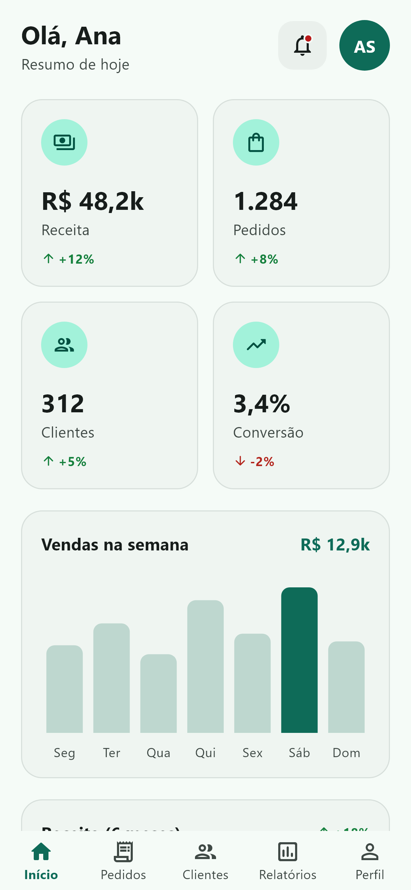
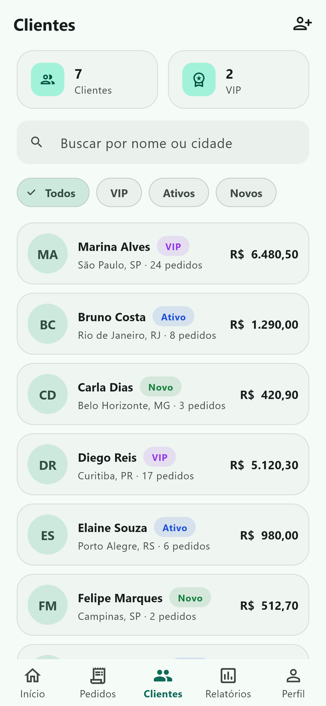

# Flutter Dashboard

[Leia em português](./README.pt-BR.md)

[](./LICENSE) 

Flutter Dashboard is a free admin panel template for e-commerce and sales teams, built with Flutter 3.44 and Material 3. It has 9 screens: an overview with KPI cards and charts, analytics by period, orders with search and filters, order detail with a status timeline, customers with segments, customer profile, reports with mini charts, notifications and settings. The bar, line and donut charts are drawn with `CustomPaint`, so there is no charting dependency, and there are no network images. Data comes from a mocked service layer; the repository and service classes mark where a real API plugs in.

## Screens

9 screens, reached through a bottom navigation bar plus go_router routes:

- Overview (`/`): KPI metric cards with deltas, charts and the latest orders.
- Analytics (`/analytics`): metrics and charts filtered by period.
- Orders (`/orders`): order list with search and status filters.
- Order detail (`/orders/:id`): order items and a status timeline.
- Customers (`/customers`): customer list with segments.
- Customer profile (`/customers/:id`): individual customer data and history.
- Reports (`/reports`): report cards with mini charts.
- Notifications (`/notifications`): notification feed.
- Settings (`/settings`): app preferences.

## Screenshots

The `screenshots/` folder contains 18 PNGs: a light and a dark capture of each screen, generated by `test/print_test.dart`. A sample:







## Tech stack

| Package | Version |
| --- | --- |
| Flutter | 3.44 (stable) |
| Dart SDK | `^3.12.2` |
| go_router | `^17.3.0` |
| provider | `^6.1.5+1` |
| http | `^1.6.0` |
| intl | `^0.20.3` |
| cupertino_icons | `^1.0.8` |
| flutter_lints (dev) | `^6.0.0` |

Material 3 is enabled through `useMaterial3: true` with a seed-based color scheme. Charts are custom painters, not a library.

## Requirements

- Flutter SDK, stable channel. The template was built with Flutter 3.44; `pubspec.lock` resolves with Flutter 3.38.0 or newer and Dart `>=3.12.2 <4.0.0`.
- No backend, API keys or environment variables.
- The usual platform toolchains for the targets you build: Android SDK for APKs, Xcode on macOS for iOS, Chrome for web, Visual Studio with the C++ workload for Windows. The repo ships `android/`, `ios/`, `web/` and `windows/` folders.

## Getting started

```bash
flutter pub get
flutter run
```

`flutter run` uses the connected device. List targets with `flutter devices` and pick one with `-d`, for example `flutter run -d chrome` for web or `flutter run -d windows` for desktop.

## Builds

```bash
flutter build apk        # Android
flutter build ipa        # iOS (requires macOS and Xcode)
flutter build web        # web output in build/web
flutter build windows    # Windows desktop
```

## Tests

`flutter test` runs the widget tests in `test/widget_test.dart`. `test/print_test.dart` (with helpers in `test/golden_utils.dart`) renders every screen in both themes and writes the PNGs in `screenshots/`.

## Project structure

```
lib/
  main.dart                 # entry point
  app.dart                  # MaterialApp.router with light and dark themes
  core/
    router.dart             # go_router route table (nested order/customer routes)
    theme.dart              # AppTheme: seed color, semantic accents, component themes
  data/
    models/                 # API models (metric, order, customer) with fromJson/toJson
    services/               # http-based DashboardApiService (mocked)
    repositories/           # DashboardRepository consumed by the view models
  domain/
    models/                 # Metric, Order, Customer, Analytics, Report, AppNotification
  ui/
    core/widgets/           # shared widgets
    features/<feature>/
      views/                # one screen per feature
      view_models/          # ChangeNotifier view models (MVVM)
```

## Architecture and state management

The code follows a layered architecture (data, domain, ui) with MVVM. Each screen has a `ChangeNotifier` view model injected via `provider`; view models call `DashboardRepository`, which maps API models from the service layer into domain models. Navigation is declarative with go_router: `/orders/:id` and `/customers/:id` are nested detail routes, and `analytics` and `notifications` hang off the root route.

## Theming and customization

The theme is centralized in `lib/core/theme.dart`. Colors derive from a single seed color (`AppTheme.seed`, `0xFF0E7C66`); change it and `ColorScheme.fromSeed` regenerates both the light and the dark palettes. The same file also defines four fixed semantic accents used by status chips and deltas (`positive`, `negative`, `warning`, `info`), the font family (Roboto) and the component themes for buttons, inputs and cards. The app follows the system brightness because `app.dart` passes both `theme` and `darkTheme` to `MaterialApp.router`.

## More templates

This template is part of the catalog at https://template.dev.br, which lists free and paid templates with previews.

## Support this project

Donations keep the free templates maintained and compatible with new Flutter releases. If this one is useful to you, you can contribute any amount at https://template.dev.br/doar?template=flutter-dashboard.

## License

MIT, see [LICENSE](./LICENSE). Copyright 2026 Danilo Quinelato.
