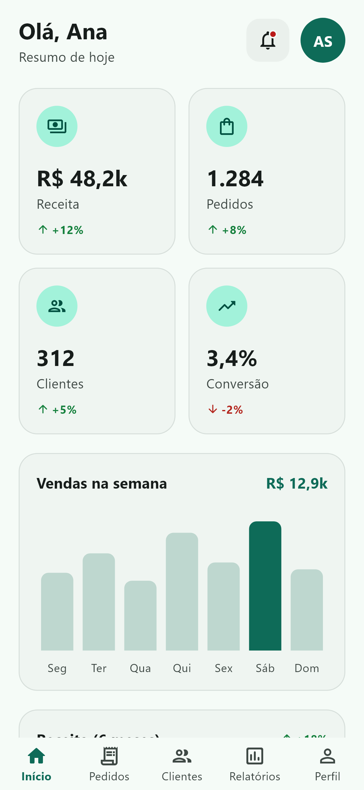
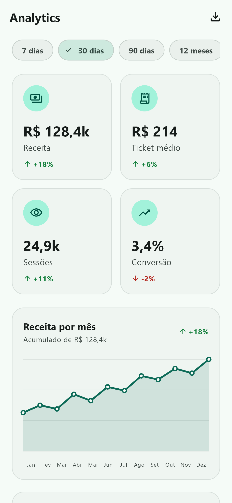
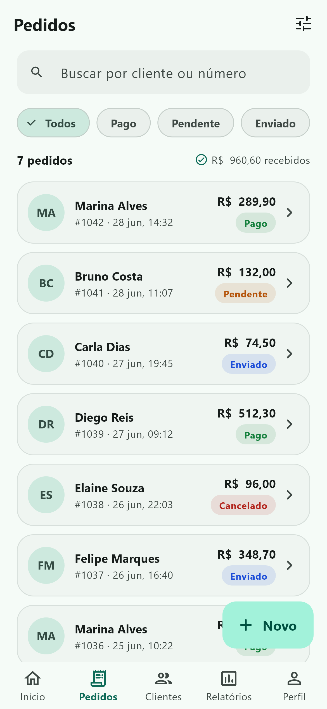
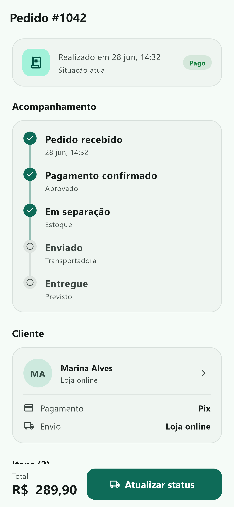
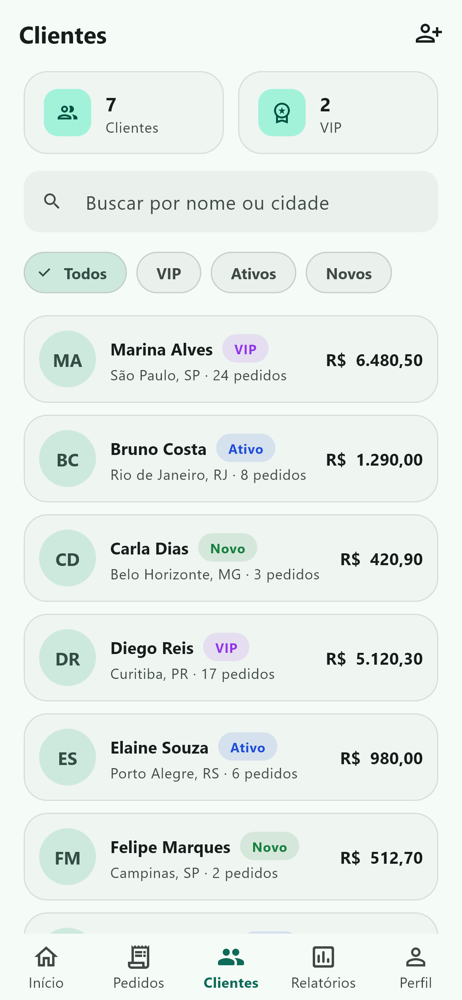
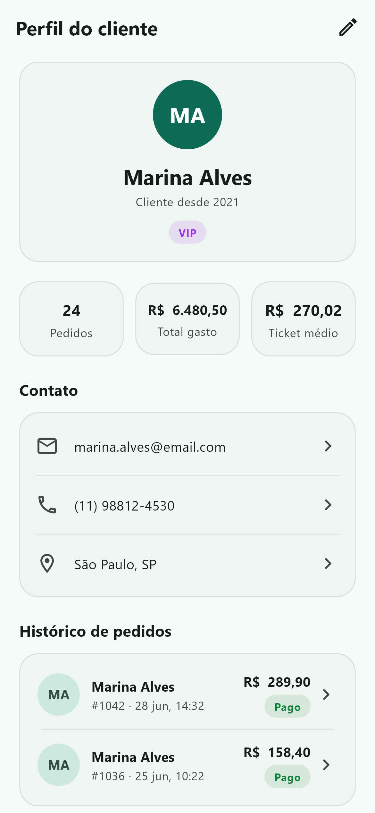

# Flutter Dashboard

[Read in English](./README.md)

[](./LICENSE) 

O Flutter Dashboard é um template gratuito de painel administrativo para e-commerce e vendas, feito com Flutter 3.44 e Material 3. São 9 telas: visão geral com cards de KPI e gráficos, analytics por período, pedidos com busca e filtros, detalhe do pedido com timeline de status, clientes com segmentos, perfil do cliente, relatórios com mini-gráficos, notificações e configurações. Os gráficos de barras, linha e rosca são desenhados com `CustomPaint`, então não há dependência de charting, e não há imagens de rede. Os dados vêm de uma camada de serviço mockada; as classes de repositório e serviço indicam onde uma API real se encaixa.

## Telas

9 telas, acessadas por uma bottom navigation bar mais rotas do go_router:

- Visão geral (`/`): cards de métrica com deltas, gráficos e os últimos pedidos.
- Analytics (`/analytics`): métricas e gráficos filtrados por período.
- Pedidos (`/orders`): lista de pedidos com busca e filtros de status.
- Detalhe do pedido (`/orders/:id`): itens do pedido e timeline de status.
- Clientes (`/customers`): lista de clientes com segmentos.
- Perfil do cliente (`/customers/:id`): dados e histórico do cliente.
- Relatórios (`/reports`): cards de relatório com mini-gráficos.
- Notificações (`/notifications`): feed de notificações.
- Configurações (`/settings`): preferências do app.

## Capturas de tela

A pasta `screenshots/` contém 18 PNGs: uma captura clara e uma escura de cada tela, geradas por `test/print_test.dart`. Uma amostra:








## Stack

| Pacote | Versão |
| --- | --- |
| Flutter | 3.44 (stable) |
| Dart SDK | `^3.12.2` |
| go_router | `^17.3.0` |
| provider | `^6.1.5+1` |
| http | `^1.6.0` |
| intl | `^0.20.3` |
| cupertino_icons | `^1.0.8` |
| flutter_lints (dev) | `^6.0.0` |

O Material 3 é habilitado via `useMaterial3: true` com esquema de cores baseado em seed. Os gráficos são custom painters, não uma biblioteca.

## Requisitos

- Flutter SDK, canal stable. O template foi construído com Flutter 3.44; o `pubspec.lock` resolve com Flutter 3.38.0 ou mais novo e Dart `>=3.12.2 <4.0.0`.
- Sem backend, chaves de API ou variáveis de ambiente.
- As toolchains de cada plataforma que você for compilar: Android SDK para APKs, Xcode no macOS para iOS, Chrome para web, Visual Studio com o workload de C++ para Windows. O repositório inclui as pastas `android/`, `ios/`, `web/` e `windows/`.

## Como rodar

```bash
flutter pub get
flutter run
```

O `flutter run` usa o dispositivo conectado. Liste os alvos com `flutter devices` e escolha um com `-d`, por exemplo `flutter run -d chrome` para web ou `flutter run -d windows` para desktop.

## Builds

```bash
flutter build apk        # Android
flutter build ipa        # iOS (requer macOS e Xcode)
flutter build web        # saída web em build/web
flutter build windows    # desktop Windows
```

## Testes

`flutter test` executa os testes de widget em `test/widget_test.dart`. O `test/print_test.dart` (com utilitários em `test/golden_utils.dart`) renderiza cada tela nos dois temas e grava os PNGs em `screenshots/`.

## Estrutura do projeto

```
lib/
  main.dart                 # ponto de entrada
  app.dart                  # MaterialApp.router com temas claro e escuro
  core/
    router.dart             # tabela de rotas do go_router (rotas aninhadas de pedido/cliente)
    theme.dart              # AppTheme: cor seed, acentos semânticos, temas de componentes
  data/
    models/                 # modelos de API (metric, order, customer) com fromJson/toJson
    services/               # DashboardApiService via http (mockado)
    repositories/           # DashboardRepository consumido pelos view models
  domain/
    models/                 # Metric, Order, Customer, Analytics, Report, AppNotification
  ui/
    core/widgets/           # widgets compartilhados
    features/<feature>/
      views/                # uma tela por feature
      view_models/          # view models ChangeNotifier (MVVM)
```

## Arquitetura e gerenciamento de estado

O código segue arquitetura em camadas (data, domain, ui) com MVVM. Cada tela tem um view model `ChangeNotifier` injetado via `provider`; os view models chamam o `DashboardRepository`, que converte os modelos de API da camada de serviço em modelos de domínio. A navegação é declarativa com go_router: `/orders/:id` e `/customers/:id` são rotas de detalhe aninhadas, e `analytics` e `notifications` ficam sob a rota raiz.

## Tema e customização

O tema está centralizado em `lib/core/theme.dart`. As cores derivam de uma única cor seed (`AppTheme.seed`, `0xFF0E7C66`); troque essa cor e o `ColorScheme.fromSeed` regenera as paletas clara e escura. O mesmo arquivo também define quatro acentos semânticos fixos usados por chips de status e deltas (`positive`, `negative`, `warning`, `info`), a fonte (Roboto) e os temas de componentes de botões, inputs e cards. O app segue o brilho do sistema porque o `app.dart` passa `theme` e `darkTheme` ao `MaterialApp.router`.

## Mais templates

Este template faz parte do catálogo em https://template.dev.br, que lista os templates gratuitos e pagos com previews.

## Apoie o projeto

As doações mantêm os templates gratuitos atualizados e compatíveis com as novas versões do Flutter. Se este template foi útil para você, contribua com qualquer valor em https://template.dev.br/doar?template=flutter-dashboard.

## Licença

MIT, veja [LICENSE](./LICENSE). Copyright 2026 Danilo Quinelato.
